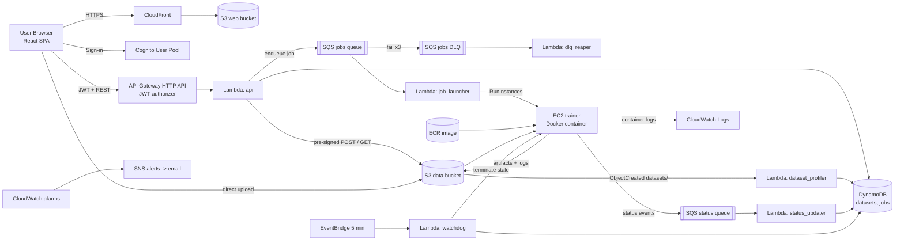

# CloudTrain — Complete Implementation Specification

**Audience:** an autonomous AI coding agent (Google Antigravity or similar) working inside a repository, plus the three-person student team supervising it.
**Goal:** build, test, deploy and document CloudTrain end to end: a no-code, cloud-based ML model training platform on AWS, at (near) zero cost.
**How to use:** save this file as `SPEC.md` in the repo root. Paste the *Kickoff Prompt* below into the agent. The agent executes Phases P0–P11 (Section 19) in order.

---

## 0. Kickoff Prompt (paste this into the agent)

> You are the lead implementing engineer for CloudTrain. Read `SPEC.md` completely before writing any code. Execute Phases P0 through P11 in the order given in Section 19. Rules:
> 1. Before each phase, write a short plan. After each phase, run that phase's *Definition of Done* checks and report results (pass/fail with command output) before continuing.
> 2. Never ask questions except at steps tagged **[HUMAN]**; for anything ambiguous, choose the option this spec recommends and record the choice in `docs/DECISIONS.md`.
> 3. Never commit secrets, AWS keys, `.tfstate`, `.env` files or datasets larger than 1 MB.
> 4. Never run `terraform apply` or `terraform destroy` against a real AWS account unless the human has confirmed credentials and the step is tagged **[HUMAN]**. Everything else (code, unit tests, local docker-compose runs, `terraform validate/plan -backend=false`) you run autonomously.
> 5. Keep every cost guardrail in Section 17 intact. If a change would remove one, stop and flag it.
> 6. Commit in small, conventional commits (`feat:`, `fix:`, `infra:`, `docs:`, `test:`).
> 7. When finished, produce `docs/COMPLETION_REPORT.md` mapping every acceptance criterion in Section 20 to evidence.

### Operating rules for the agent
- **Language/tooling versions:** Python 3.12 (Lambdas), Python 3.11 (training container), Node 20 LTS, Terraform ≥ 1.10, AWS provider `~> 6.0`, Docker ≥ 24.
- **Code quality:** Python formatted with `ruff format` and linted with `ruff check`; type hints everywhere; `mypy --strict` on `backend/common` and `trainer`. TypeScript `strict: true`; ESLint + Prettier.
- **Every module gets tests.** No phase is "done" until its tests pass.
- **Idempotent & re-runnable:** all scripts must be safe to run twice.
- **Fail loudly:** no bare `except:`; log structured JSON with `job_id`, `dataset_id`, `user_id` where relevant.
- **Human-gated items** are collected in Section 3. Prepare everything the human needs (commands, values) and then pause.

---

## 1. Project Summary

CloudTrain is a mini "SageMaker Canvas": a web app where a signed-in user uploads a CSV dataset, clicks through a wizard (target column → features → model → hyperparameters → compute size), presses **Train**, watches the job progress, and downloads the trained model with its metrics. Datasets live in S3, training runs on on-demand EC2 instances that terminate themselves, jobs flow through SQS queues, state lives in DynamoDB, and **all infrastructure is Terraform, deployed by GitHub Actions**.

### 1.1 In scope (MVP — must ship)
- Auth (sign-up/sign-in) via Cognito.
- CSV upload (≤ 100 MB) straight to S3 via pre-signed POST; automatic profiling (columns, types, missing values, preview).
- Tabular **classification and regression** with scikit-learn and XGBoost; automatic preprocessing.
- Job queue (SQS) with dead-letter handling, concurrency control and back-pressure.
- On-demand EC2 training, Dockerised, self-terminating.
- Results dashboard: status timeline, live logs, metrics, charts, artifact downloads.
- Terraform for everything; GitHub Actions CI/CD with OIDC (no long-lived keys).
- Cost guardrails, observability, security baseline, documentation.

### 1.2 Stretch (only after MVP acceptance passes)
S1 image classification (transfer learning, CPU), S2 ONNX export, S3 job comparison page, S4 email notification on completion (SNS/SES), S5 optional RDS PostgreSQL repository, S6 hyperparameter auto-search (random search).

### 1.3 Non-goals
Custom user code execution, multi-tenant billing, GPU training, real-time inference endpoints, org/team sharing.

### 1.4 Mapping to the original synopsis modules

| Synopsis module | Implemented by |
|---|---|
| Dataset Upload Module | `api` Lambda (pre-signed POST) + S3 + `dataset_profiler` Lambda + Datasets page |
| Training Configuration Module | Wizard UI + model registry (`shared/model_registry.json`) + validation in `api` + DynamoDB `jobs` (config stored per job, versioned by `config_version`) |
| Cloud Job Queue Module | SQS `jobs` queue + DLQ + `job_launcher` Lambda + `dlq_reaper` + `watchdog` |
| Compute Provisioning & Training Module | EC2 launched from Terraform-managed launch template, user-data bootstrap, Docker training container from ECR |
| Artifact Storage & Results Dashboard | S3 `jobs/…/artifacts`, `status` SQS queue + `status_updater`, React dashboard |

---

## 2. Key Decisions and Deviations from the Synopsis

| # | Decision | Rationale | Where it differs from synopsis |
|---|---|---|---|
| D1 | **DynamoDB** is the default metadata store; RDS PostgreSQL is an optional module (`enable_rds=false`) behind the same repository interface | RDS has no free tier on new AWS accounts and runs 24/7; DynamoDB is free-tier friendly | Synopsis names RDS; keep an RDS DDL + module as stretch S5 so the report can still cover it |
| D2 | Region default `ap-south-1` (Mumbai), configurable | Team is in India; lower latency | — |
| D3 | No NAT Gateway, no ALB, no Elastic IPs, no RDS by default | Each costs money continuously | — |
| D4 | Lambdas are **not** placed in a VPC | They only talk to AWS public APIs; avoids NAT | — |
| D5 | Training instances live in public subnets with **no inbound rules**; admin access only via SSM Session Manager | No SSH keys to leak | — |
| D6 | Orchestration = SQS + Lambda + status events + watchdog (no Step Functions) | Fewer moving parts; lifecycle is linear | — |
| D7 | Auth = Cognito user pool + API Gateway HTTP API JWT authorizer | Managed, free at this scale | — |
| D8 | GitHub Actions authenticates to AWS with **OIDC** role assumption | No stored access keys | — |
| D9 | EC2 instance types are driven by a Terraform variable map; defaults `t3.small`/`t3.medium` | **Verify at build time** which types the account's Free Plan allows; adjust map (e.g. `c7i-flex.large`) if blocked | — |

---

## 3. Human-Gated Steps **[HUMAN]**

The agent prepares everything; the human performs these:

1. **H1 – AWS account.** Create the account, choose the **Free Plan**, enable MFA on root, create an IAM Identity Center user or an admin IAM user for local CLI use, run `aws configure sso` (or `aws configure`). Share only the account ID and region with the agent.
2. **H2 – Budget & alerts.** Confirm an email address for `alert_email`. After the first apply, click the SNS confirmation link in the inbox.
3. **H3 – GitHub repo.** Create the repo, set its name in `infra/bootstrap/terraform.tfvars` (`github_repo = "ORG/REPO"`), and create the GitHub **Environment** `prod` with required reviewers.
4. **H4 – Bootstrap apply.** Run `cd infra/bootstrap && terraform init && terraform apply` locally once (creates state bucket, ECR repo, GitHub OIDC provider and deploy roles). Copy the outputs into GitHub repository **variables** (Section 15.4).
5. **H5 – Service quotas.** In Service Quotas, check *Running On-Demand Standard instances* (vCPU) for the region; set `max_concurrent_instances` so `max_concurrent_instances × vCPUs_per_instance ≤ quota`.
6. **H6 – First deploy approval.** Approve the `prod` environment gate when the deploy workflow pauses.
7. **H7 – Demo account.** Run `scripts/create_demo_user.py` to create a confirmed test user; keep the credentials out of git.
8. **H8 – Teardown.** When demos are finished, trigger the `destroy` workflow (or `make destroy`).

---

## 4. Architecture



### 4.1 End-to-end flows

**Flow A — Dataset upload**
1. UI calls `POST /datasets` with filename and size. `api` validates, creates a `datasets` item (`PENDING_UPLOAD`), returns a pre-signed POST (15-min expiry, `content-length-range` 1…100 MB, content-type `text/csv`).
2. Browser POSTs the file directly to S3 (progress bar via `XMLHttpRequest`).
3. S3 `ObjectCreated` on prefix `datasets/` suffix `.csv` triggers `dataset_profiler`, which sets `PROFILING`, streams the CSV, writes the profile into DynamoDB, sets `READY` (or `INVALID` with reasons).
4. UI polls `GET /datasets/{id}` every 3 s until `READY`/`INVALID`.

**Flow B — Job submission**
1. UI calls `POST /jobs` with the wizard's config JSON (Section 9).
2. `api` validates against the dataset profile and model registry, enforces per-user quotas, writes the job (`QUEUED`), writes `config.json` to S3, sends `{job_id, user_id, requeue_count:0}` to the jobs queue, returns `202`.

**Flow C — Execution**
1. `job_launcher` receives the message, acquires a capacity slot (Section 8.4), conditionally moves the job `QUEUED → PROVISIONING`, and calls `RunInstances` with the launch template, instance type from compute size, tags and generated user-data.
2. The instance boots, pulls the image from ECR, runs the container with env vars for the job.
3. The container sends status events to the status queue; `status_updater` applies them (`RUNNING`, progress %, stages, metrics summary, `UPLOADING`, `SUCCEEDED`/`FAILED`).
4. The container uploads artifacts to S3, exits; user-data's `trap` shuts the instance down (shutdown behaviour = terminate).
5. `watchdog` cleans up anything that got stuck.

**Flow D — Results**
UI polls `GET /jobs/{id}` (5 s while active) and `GET /jobs/{id}/logs`; on success calls `GET /jobs/{id}/artifacts` to receive 15-minute pre-signed download URLs.

---

## 5. Repository Layout

```
cloudtrain/
├── SPEC.md                         # this file
├── README.md
├── Makefile                        # make setup | test | lint | package | local-up | local-down | e2e | deploy-plan | destroy
├── .github/workflows/{ci.yml,deploy.yml,destroy.yml}
├── shared/
│   ├── model_registry.json         # single source of truth for models + hyperparameters
│   ├── job_config.schema.json      # JSON Schema of the training config
│   └── status_event.schema.json    # JSON Schema of container->platform status events
├── backend/
│   ├── pyproject.toml
│   ├── common/                     # config.py, ddb.py, s3.py, sqs.py, states.py, schemas.py, registry.py, errors.py, logging.py
│   ├── api/handler.py              # router + routes_{datasets,jobs,meta}.py
│   ├── dataset_profiler/handler.py
│   ├── job_launcher/{handler.py,compute.py}   # compute.py: Ec2Backend, LocalDockerBackend
│   ├── status_updater/handler.py
│   ├── dlq_reaper/handler.py
│   ├── watchdog/handler.py
│   ├── pre_signup/handler.py
│   ├── tests/
│   └── build.sh                    # builds per-function zips into build/lambda/
├── trainer/
│   ├── Dockerfile
│   ├── pyproject.toml
│   ├── cloudtrain_trainer/{main.py,config.py,data_loader.py,preprocess.py,models.py,evaluate.py,artifacts.py,status.py,report.py,errors.py}
│   └── tests/
├── frontend/                       # Vite + React + TS
│   ├── package.json, vite.config.ts, tsconfig.json, tailwind.config.ts
│   ├── public/config.example.json
│   └── src/{main.tsx,App.tsx,api/,auth/,pages/,components/,hooks/,lib/,types/}
├── infra/
│   ├── bootstrap/                  # state bucket, ECR, GitHub OIDC + roles (applied once, locally)
│   ├── main.tf, variables.tf, outputs.tf, versions.tf, backend.tf, terraform.tfvars.example
│   └── modules/{network,storage,database,messaging,auth,compute,lambdas,api,frontend,observability}/
├── scripts/{create_demo_user.py,e2e_smoke.py,make_sample_datasets.py,redrive_dlq.sh,cleanup_orphans.py}
├── samples/                        # generated small CSVs (<1 MB): iris, wine, breast_cancer, diabetes, messy_churn
├── docker-compose.local.yml        # local emulator + trainer + frontend dev
└── docs/{ARCHITECTURE.md,API.md,openapi.yaml,COST.md,RUNBOOK.md,DEMO_SCRIPT.md,DECISIONS.md,COMPLETION_REPORT.md}
```

---

## 6. Global Conventions

- **Resource naming:** `cloudtrain-${env}-<thing>` (e.g. `cloudtrain-prod-jobs`). `env` defaults to `prod` (single environment is fine for a class project; keep the variable).
- **Mandatory tags on every taggable resource:** `Project=cloudtrain`, `Env=${env}`, `ManagedBy=terraform`. Training instances additionally get `JobId`, `UserId`, `Role=trainer`.
- **IDs:** `user_id` = Cognito `sub`; `dataset_id`, `job_id` = UUIDv4 (lowercase, hyphenated).
- **Time:** ISO-8601 UTC strings (`2026-10-19T10:15:30Z`) everywhere; DynamoDB attribute `ttl` (epoch seconds) only where noted.
- **Errors:** API errors always `{"error": {"code": "SNAKE_CASE", "message": "human text", "details": {...}}}` with correct HTTP status.
- **Config via environment variables** (Lambdas): `ENV`, `AWS_REGION`, `DATASETS_TABLE`, `JOBS_TABLE`, `DATA_BUCKET`, `JOBS_QUEUE_URL`, `STATUS_QUEUE_URL`, `TRAINER_IMAGE_URI`, `LAUNCH_TEMPLATE_ID`, `SUBNET_IDS` (comma-sep), `MAX_CONCURRENT_INSTANCES`, `MAX_ACTIVE_JOBS_PER_USER`, `MAX_DATASET_BYTES`, `MAX_RUNTIME_MINUTES`, `INSTANCE_TYPE_SMALL`, `INSTANCE_TYPE_MEDIUM`, `TRAINING_LOG_GROUP`, `LOG_LEVEL`, `COMPUTE_BACKEND` (`ec2`|`local`).
- **Defaults (Terraform variables):** `max_dataset_bytes=104857600`, `max_active_jobs_per_user=3`, `max_datasets_per_user=10`, `max_concurrent_instances=2`, `max_runtime_minutes=60`, `artifact_retention_days=30`, `log_retention_days=14`.

---

## 7. Data Model

### 7.1 S3 layout (single private data bucket `cloudtrain-${env}-${account_id}-data`)

```
datasets/{user_id}/{dataset_id}/data.csv
jobs/{user_id}/{job_id}/config.json                 # resolved config written by api
jobs/{user_id}/{job_id}/artifacts/model.joblib
jobs/{user_id}/{job_id}/artifacts/metrics.json
jobs/{user_id}/{job_id}/artifacts/config.json       # config as actually used (with defaults filled in)
jobs/{user_id}/{job_id}/artifacts/feature_importance.json
jobs/{user_id}/{job_id}/artifacts/preprocessing_report.json
jobs/{user_id}/{job_id}/artifacts/model_card.md
jobs/{user_id}/{job_id}/artifacts/predict_example.py
jobs/{user_id}/{job_id}/artifacts/requirements.txt  # pinned versions needed to load model.joblib
jobs/{user_id}/{job_id}/logs.txt
```
Bucket settings: Block Public Access (all four) ON; SSE-S3 encryption; versioning OFF; bucket-owner-enforced ownership; `aws:SecureTransport` deny policy for non-TLS; lifecycle rules: `jobs/*/artifacts/` and `jobs/*/logs.txt` expire after `artifact_retention_days`; abort incomplete multipart uploads after 7 days. CORS: origins = CloudFront domain (+ `http://localhost:5173` when `enable_local_cors=true`), methods `GET, POST, HEAD`, headers `*`, expose `ETag`, max-age 3000.

### 7.2 DynamoDB (on-demand billing, point-in-time recovery OFF to save cost, SSE default)

**Table `cloudtrain-${env}-datasets`**
| Attribute | Type | Notes |
|---|---|---|
| `dataset_id` (PK) | S | |
| `user_id` | S | owner |
| `name` | S | original filename |
| `s3_key` | S | |
| `size_bytes` | N | declared at creation; confirmed by profiler from S3 `ContentLength` |
| `status` | S | `PENDING_UPLOAD` \| `PROFILING` \| `READY` \| `INVALID` |
| `profile` | M | see 7.4 (absent until READY) |
| `errors` | L<S> | reasons when INVALID |
| `created_at`, `updated_at` | S | |
GSI `user-created-index`: PK `user_id`, SK `created_at`.

**Table `cloudtrain-${env}-jobs`**
| Attribute | Type | Notes |
|---|---|---|
| `job_id` (PK) | S | special item `job_id="__capacity__"` holds `in_use` (N) — see 8.4 |
| `user_id` | S | |
| `name` | S | user-provided label |
| `dataset_id` | S | |
| `status` | S | see 7.3 |
| `stage` | S | fine-grained stage text, e.g. `PREPROCESSING` |
| `progress` | N | 0–100 |
| `config` | M | resolved config (Section 9) |
| `config_version` | N | schema version, starts at 1 |
| `instance_id` | S | set by launcher |
| `instance_type` | S | |
| `metrics_summary` | M | headline metrics for table display |
| `artifact_prefix` | S | S3 prefix of artifacts |
| `error` | M | `{code, message}` on failure |
| `last_seq` | N | last applied status-event sequence number |
| `last_event_at` | S | updated on every accepted event (watchdog uses it) |
| `created_at`, `updated_at`, `started_at`, `finished_at` | S | |
| `cancel_requested` | BOOL | |
GSIs: `user-created-index` (PK `user_id`, SK `created_at`); `status-updated-index` (PK `status`, SK `updated_at`) used by `watchdog`.

### 7.3 Job state machine

| State | Meaning | Set by | Allowed next |
|---|---|---|---|
| `QUEUED` | accepted, message in SQS | api | PROVISIONING, CANCELLED, FAILED |
| `PROVISIONING` | EC2 requested / booting / pulling image | job_launcher | RUNNING, FAILED, CANCELLED, TIMED_OUT |
| `RUNNING` | container executing training | status_updater | UPLOADING, FAILED, CANCELLED, TIMED_OUT |
| `UPLOADING` | uploading artifacts | status_updater | SUCCEEDED, FAILED, CANCELLED, TIMED_OUT |
| `SUCCEEDED` | terminal | status_updater | — |
| `FAILED` | terminal | status_updater / dlq_reaper / watchdog | — |
| `CANCELLED` | terminal | api | — |
| `TIMED_OUT` | terminal | watchdog / status_updater | — |

Rank: QUEUED 1 < PROVISIONING 2 < RUNNING 3 < UPLOADING 4 < terminal 5. **Rule:** updates may only move forward in rank; terminal states are never overwritten. Implement as `common/states.py::can_transition(old, new)` with exhaustive unit tests, and enforce in DynamoDB with `ConditionExpression` (never read-modify-write).

Dataset states: `PENDING_UPLOAD → PROFILING → READY | INVALID`.

### 7.4 Dataset profile schema (`datasets.profile`)

```json
{
  "row_count": 891,
  "column_count": 12,
  "delimiter": ",",
  "encoding": "utf-8",
  "columns": [
    {"name": "Age", "dtype": "numeric", "missing_count": 177, "missing_pct": 19.87,
     "unique_count": 88, "unique_capped": false, "sample_values": ["22","38","26"],
     "stats": {"min": 0.42, "max": 80, "mean": 29.7}},
    {"name": "Sex", "dtype": "categorical", "missing_count": 0, "missing_pct": 0,
     "unique_count": 2, "unique_capped": false, "sample_values": ["male","female"]}
  ],
  "preview_rows": [["22","male"], ["38","female"]],
  "warnings": ["Column 'PassengerId' looks like an identifier and will be excluded by default."]
}
```
`dtype` ∈ `numeric | categorical | boolean | datetime | text | constant | id_like`. Heuristics (computed on the first 10,000 data rows; `row_count` and `missing_count` use a full streaming pass):
- `numeric`: ≥ 95 % of non-empty values parse as float.
- `boolean`: values ⊆ {true,false,yes,no,0,1,t,f,y,n} (case-insensitive) with ≤ 2 distinct.
- `datetime`: ≥ 95 % parse with `datetime.fromisoformat` or a small set of common formats (`%d/%m/%Y`, `%m/%d/%Y`, `%Y-%m-%d %H:%M:%S`).
- `constant`: exactly one distinct non-empty value.
- `id_like`: non-float column with unique ratio ≥ 0.95 and > 20 rows, or name matches `(^id$|_id$|^id_|uuid|guid|index)` (case-insens.) with high uniqueness.
- `text`: string column with unique ratio > 0.5 **and** mean length > 30.
- else `categorical`.
Validation → `INVALID` if: file empty/no header; > 500 columns; > 1,000,000 rows; duplicate or blank column names; not decodable as UTF-8 (try `utf-8-sig`, then `latin-1`, record encoding); fewer than 20 data rows; delimiter undetectable (try `, ; \t |` via `csv.Sniffer` limited to those).

### 7.5 Status event schema (container → status queue)

```json
{
  "job_id": "uuid", "seq": 7, "ts": "2026-10-19T10:15:30Z",
  "event": "STAGE | PROGRESS | METRICS | UPLOADING | SUCCEEDED | FAILED",
  "status": "RUNNING",
  "stage": "TRAINING",
  "progress": 55,
  "message": "Fitting RandomForestClassifier (n_estimators=100)",
  "payload": {"metrics_summary": {"accuracy": 0.912}, "error": {"code": "TARGET_CONSTANT", "message": "…"}}
}
```
`seq` starts at 1 and increments for every event from that run. Stages in order: `BOOTSTRAP, DOWNLOADING, VALIDATING, PREPROCESSING, TRAINING, EVALUATING, EXPLAINING, UPLOADING, DONE`. Progress mapping: BOOTSTRAP 5, DOWNLOADING 10, VALIDATING 15, PREPROCESSING 25, TRAINING 40→75 (if CV, advance per fold), EVALUATING 80, EXPLAINING 88, UPLOADING 95, DONE 100. Messages are SQS **standard** queue messages (at-least-once, unordered) — consumers must tolerate duplicates and reordering using `seq`.

---

## 8. Messaging (SQS) — Complete Design

### 8.1 Queues

| Queue | Type | Visibility timeout | Retention | Long poll | Redrive | Encryption |
|---|---|---|---|---|---|---|
| `cloudtrain-${env}-jobs` | Standard | **360 s** (6 × launcher timeout 60 s) | 4 days | 20 s | `maxReceiveCount=3` → jobs DLQ | SSE-SQS |
| `cloudtrain-${env}-jobs-dlq` | Standard | 60 s | 14 days | 20 s | — | SSE-SQS |
| `cloudtrain-${env}-status` | Standard | **180 s** (6 × updater timeout 30 s) | 4 days | 20 s | `maxReceiveCount=5` → status DLQ | SSE-SQS |
| `cloudtrain-${env}-status-dlq` | Standard | 60 s | 14 days | 20 s | — | SSE-SQS |

Each DLQ has `redrive_allow_policy` restricting to its source queue. Queue policies deny non-TLS (`aws:SecureTransport=false`). **Why standard, not FIFO:** throughput needs are tiny, standard queues are cheaper and simpler, and idempotency is handled in code (8.3).

### 8.2 Message schemas

Jobs queue body:
```json
{"job_id": "uuid", "user_id": "uuid", "requeue_count": 0, "enqueued_at": "2026-10-19T10:15:30Z"}
```
Message attributes: `schema_version=1`. Status queue body: the event in 7.5.

### 8.3 Consumers and idempotency

**`job_launcher`** (event source mapping): `batch_size=1`, `maximum_concurrency=2` (the minimum allowed; keeps launches slow and safe), `function_response_types=["ReportBatchItemFailures"]`.
1. Load the job. If missing, or status ≠ `QUEUED` (e.g. `CANCELLED`, already `PROVISIONING`) → acknowledge and return (idempotent skip).
2. Acquire a capacity slot (8.4). If none available → **re-enqueue** a copy with `DelaySeconds=30` and `requeue_count+1`, acknowledge the original. If `requeue_count ≥ 120` (≈ 1 h) → mark job `FAILED` with code `CAPACITY_TIMEOUT`. *(Re-enqueueing instead of letting the message return to the queue avoids burning `receiveCount` and polluting the DLQ.)*
3. Conditional update `status: QUEUED → PROVISIONING` (`ConditionExpression: #s = :queued`). If the condition fails → release slot, acknowledge.
4. `RunInstances(ClientToken=job_id, …)` (EC2 idempotency token protects against duplicate launches). On success store `instance_id`, `instance_type`, `started_at`. On `InsufficientInstanceCapacity` / `RequestLimitExceeded` / `VcpuLimitExceeded` → release slot, set job back to `QUEUED` (conditional on `PROVISIONING`), and treat as retryable: raise so SQS redelivers (counts toward `maxReceiveCount=3`). On any non-retryable error (`InvalidParameterValue`, `UnauthorizedOperation`) → release slot, mark `FAILED` (`LAUNCH_ERROR`), acknowledge.

**`status_updater`**: batch up to 10, `maximum_concurrency=5`, partial batch failures enabled. For each event: validate against schema (drop + log invalid), then a single `UpdateItem` with condition `attribute_exists(job_id) AND (attribute_not_exists(last_seq) OR last_seq < :seq) AND rank(status) <= rank(:new) AND NOT status IN terminal`. If the condition fails the event is stale/duplicate → acknowledge silently. When an event moves the job to a terminal state, also release the capacity slot (idempotent — see 8.4) and set `finished_at`.

**`dlq_reaper`**: triggered by the jobs DLQ. For each message: if the job is non-terminal, mark `FAILED` with `error.code=DISPATCH_FAILED` and message "The job could not be dispatched after 3 attempts", release slot, delete message. Also emit a structured log line used by a CloudWatch metric filter. The **status DLQ has no automatic consumer**: it only raises an alarm (a human inspects with `scripts/redrive_dlq.sh`).

### 8.4 Capacity slots (concurrency control)
Item `job_id="__capacity__"` in the jobs table with attribute `in_use` (N, starts 0).
- **Acquire:** `UpdateItem ADD in_use :one` with `ConditionExpression: attribute_not_exists(in_use) OR in_use < :max`. `ConditionalCheckFailed` ⇒ no slot.
- **Release:** `UpdateItem ADD in_use :minus_one` with `ConditionExpression: in_use > :zero`. Release exactly once per job: set a boolean `slot_released` on the job item in the same `TransactWriteItems` as the decrement (condition `attribute_not_exists(slot_released)`).
- **Reconcile:** every `watchdog` run recomputes `in_use` = count of jobs whose status ∈ {PROVISIONING, RUNNING, UPLOADING} and whose slot is not released, and overwrites the counter if it drifted (log a warning when it does).

### 8.5 Watchdog (EventBridge `rate(5 minutes)`)
For each job in `PROVISIONING`, `RUNNING`, `UPLOADING` (query `status-updated-index`):
- `now − last_event_at (or started_at) > MAX_RUNTIME_MINUTES + 10 min` → call `ec2:TerminateInstances` (only on instances tagged `Project=cloudtrain`), mark `TIMED_OUT`, release slot.
- Instance state is `terminated`/`shutting-down` (via `DescribeInstances`) and job still non-terminal for > 2 min → mark `FAILED` with `INSTANCE_LOST` (container died without reporting), release slot.
- `PROVISIONING` for > 15 min with no event → terminate + mark `FAILED` (`BOOT_TIMEOUT`).
Then: terminate orphan instances tagged `Project=cloudtrain,Role=trainer` that are older than `MAX_RUNTIME_MINUTES + 30 min` or whose `JobId` is terminal; delete `PENDING_UPLOAD` datasets older than 1 h whose S3 object does not exist; reconcile the capacity counter.

---

## 9. Model Registry and Training Config

### 9.1 Registry (`shared/model_registry.json`)
Structure (agent must generate the full file from the table below and a unit test must assert that every `class_path` imports and that every default is within its range):

```json
{
  "version": 1,
  "models": [
    {
      "id": "random_forest",
      "display_name": "Random Forest",
      "description": "An ensemble of decision trees. Strong default for tabular data; robust to outliers.",
      "tasks": ["classification", "regression"],
      "class_path": {"classification": "sklearn.ensemble.RandomForestClassifier",
                     "regression": "sklearn.ensemble.RandomForestRegressor"},
      "fixed_params": {"n_jobs": -1},
      "needs_scaling": false,
      "supports_native_importance": true,
      "hyperparameters": [
        {"name": "n_estimators", "label": "Number of trees", "type": "int", "min": 10, "max": 500, "default": 100, "step": 10, "help": "More trees = better but slower."},
        {"name": "max_depth", "label": "Max depth", "type": "int", "min": 1, "max": 50, "default": null, "nullable": true},
        {"name": "min_samples_leaf", "label": "Min samples per leaf", "type": "int", "min": 1, "max": 20, "default": 1},
        {"name": "max_features", "label": "Features per split", "type": "enum", "options": ["sqrt", "log2", null], "default": "sqrt"}
      ]
    }
  ]
}
```
Hyperparameter `type` ∈ `int | float | enum | bool`; floats may have `"scale": "log"`. The UI renders controls directly from this file (slider for int/float, select for enum, switch for bool, a "None" checkbox when `nullable`).

| Model id | Tasks | Classes | Hyperparameters (`name: type [range] = default`) |
|---|---|---|---|
| `logistic_regression` | cls | `LogisticRegression` | `C: float log [0.001–100]=1.0`, `max_iter: int [100–5000]=1000`, `class_weight: enum [null,"balanced"]=null` (needs scaling) |
| `linear_regression` | reg | `LinearRegression` | none (needs scaling) |
| `ridge` | reg | `Ridge` | `alpha: float log [0.001–1000]=1.0` (needs scaling) |
| `decision_tree` | cls, reg | `DecisionTreeClassifier/Regressor` | `max_depth: int [1–50]=6 nullable`, `min_samples_split: int [2–50]=2`, `min_samples_leaf: int [1–20]=1`, `criterion` enum (cls: `gini, entropy`; reg: `squared_error, absolute_error`) |
| `random_forest` | cls, reg | `RandomForestClassifier/Regressor` | as JSON above |
| `xgboost` | cls, reg | `xgboost.XGBClassifier/XGBRegressor` | `n_estimators: int [10–500]=200`, `max_depth: int [1–12]=6`, `learning_rate: float log [0.01–0.5]=0.1`, `subsample: float [0.5–1.0]=1.0`, `colsample_bytree: float [0.5–1.0]=1.0`; fixed `tree_method="hist"`, `n_jobs=-1`, `eval_metric` auto |
| `knn` | cls, reg | `KNeighborsClassifier/Regressor` | `n_neighbors: int [1–50]=5`, `weights: enum [uniform, distance]=uniform` (needs scaling) |

Models flagged "needs scaling" force `scale_numeric=true` regardless of the user's choice (UI shows a note).

### 9.2 Training config (`POST /jobs` body and `config.json`)

```json
{
  "config_version": 1,
  "name": "Titanic RF v1",
  "dataset_id": "uuid",
  "task": "auto",
  "target_column": "Survived",
  "feature_columns": null,
  "model": {"id": "random_forest", "hyperparameters": {"n_estimators": 200, "max_depth": 8}},
  "preprocessing": {"numeric_impute": "median", "categorical_impute": "most_frequent",
                    "scale_numeric": true, "max_categories": 50, "drop_id_like": true},
  "split": {"test_size": 0.2, "stratify": true, "random_state": 42},
  "cross_validation": {"folds": 0},
  "compute": {"size": "small"},
  "max_runtime_minutes": 30
}
```
Validation rules (implemented in `common/schemas.py` + registry, tested exhaustively):
- `name`: 1–80 chars. `dataset_id` must belong to the caller and be `READY`.
- `task` ∈ `auto|classification|regression`. `auto` resolution (done by `api` **and** re-checked by trainer): target `dtype=numeric` with `unique_count > 20` (or float-valued) ⇒ regression; otherwise classification. A user-forced `classification` on a numeric target with > 50 unique values is rejected (`TARGET_NOT_CATEGORICAL`).
- `target_column` exists, is not `constant`/`id_like`/`text`/`datetime`, has ≤ 5 % missing (rows with missing target are dropped; reject if > 5 %).
- `feature_columns`: `null` = all columns except target and auto-excluded ones; otherwise a non-empty subset that excludes the target.
- `model.id` supports the resolved task; each hyperparameter is known, type-correct and within range (unknown keys rejected, defaults filled in).
- `numeric_impute` ∈ `mean|median|zero`; `categorical_impute` ∈ `most_frequent|missing_label`; `max_categories` 2–100; `test_size` 0.1–0.4; `folds` 0 or 3–10.
- `compute.size` ∈ `small|medium`; `max_runtime_minutes` 5–`MAX_RUNTIME_MINUTES`.
- Per-user limits: ≤ `MAX_ACTIVE_JOBS_PER_USER` jobs in non-terminal states (`429 TOO_MANY_ACTIVE_JOBS`).

---

## 10. Backend API

### 10.1 API Gateway (HTTP API, payload v2.0)
Single Lambda integration (`api`), JWT authorizer (issuer `https://cognito-idp.${region}.amazonaws.com/${pool_id}`, audience = app client id; the SPA sends the **access token** in `Authorization: Bearer`). Default-route throttling: burst 50, rate 25 req/s. CORS: allowed origin = CloudFront domain (+ localhost in dev), headers `authorization, content-type`, methods `GET, POST, DELETE, OPTIONS`. Access logs to CloudWatch (14-day retention). `user_id` is read from `event.requestContext.authorizer.jwt.claims.sub`; **every** item access verifies `item.user_id == user_id` and returns `404` (not 403) on mismatch.

### 10.2 Endpoints

| Method & path | Purpose | Success | Notable errors |
|---|---|---|---|
| `GET /me` | caller info + quotas in use | 200 `{user_id, email, quotas:{datasets_used, datasets_max, active_jobs, active_jobs_max}}` | — |
| `GET /models` | registry JSON | 200 | — |
| `POST /datasets` | create dataset + pre-signed POST | 201 `{dataset_id, upload:{url, fields}, expires_in:900}` | `400 INVALID_FILENAME` (must end `.csv`), `413 FILE_TOO_LARGE`, `429 DATASET_LIMIT` |
| `GET /datasets` | list (newest first, `?limit=&cursor=`) | 200 `{items, next_cursor}` | — |
| `GET /datasets/{id}` | detail incl. profile | 200 | `404` |
| `DELETE /datasets/{id}` | delete item + S3 object | 204 | `409 DATASET_IN_USE` if a non-terminal job references it |
| `POST /jobs` | validate + enqueue | 202 `{job_id, status:"QUEUED"}` | `400 VALIDATION_FAILED` (with `details.fields[]`), `409 DATASET_NOT_READY`, `429 TOO_MANY_ACTIVE_JOBS` |
| `GET /jobs` | list (`?status=&limit=&cursor=`) | 200 | — |
| `GET /jobs/{id}` | job detail incl. config, status, stage, progress, metrics_summary, error, timestamps | 200 | `404` |
| `POST /jobs/{id}/cancel` | cancel | 202 | `409 ALREADY_FINISHED` |
| `DELETE /jobs/{id}` | delete a **terminal** job + its S3 prefix | 204 | `409 JOB_ACTIVE` |
| `GET /jobs/{id}/logs?next=` | log lines | 200 `{lines:[{ts,text}], next, source:"cloudwatch"\|"s3"}` | — |
| `GET /jobs/{id}/artifacts` | pre-signed GET URLs (15 min) | 200 `{files:[{name,size,url}]}` | `409 JOB_NOT_SUCCEEDED` |
| `GET /jobs/{id}/results` | parsed `metrics.json` + `feature_importance.json` (so the UI needs only one call) | 200 | `409 JOB_NOT_SUCCEEDED` |

Cancel semantics: `QUEUED` → set `CANCELLED` (launcher skips it); `PROVISIONING|RUNNING|UPLOADING` → set `cancel_requested=true`, call `TerminateInstances` on `instance_id` (guarded by tag condition), set `CANCELLED`, release slot.

Example error:
```json
{"error": {"code": "VALIDATION_FAILED", "message": "Configuration is invalid.",
 "details": {"fields": [{"path": "model.hyperparameters.n_estimators", "message": "must be between 10 and 500"}]}}}
```
Deliver `docs/openapi.yaml` describing all of the above; CI validates it with `openapi-spec-validator`.

### 10.3 Lambda inventory

| Function | Runtime / arch | Memory | Timeout | Trigger | Key IAM (least privilege, inline policies in Terraform) |
|---|---|---|---|---|---|
| `api` | py3.12 / x86_64 | 512 MB | 15 s | API Gateway | DDB R/W both tables; S3 `GetObject/PutObject/DeleteObject` on data bucket prefixes `datasets/*`,`jobs/*` + `ListBucket` scoped by prefix; `sqs:SendMessage` jobs queue; `ec2:TerminateInstances` with `aws:ResourceTag/Project=cloudtrain`; `logs:GetLogEvents`,`DescribeLogStreams` on training log group |
| `dataset_profiler` | py3.12 | 1024 MB | 300 s | S3 `ObjectCreated` prefix `datasets/` suffix `.csv` | S3 `GetObject` `datasets/*`; DDB R/W datasets |
| `job_launcher` | py3.12 | 256 MB | 60 s | SQS jobs (batch 1, max concurrency 2) | DDB R/W jobs; `ec2:RunInstances`,`CreateTags` (restricted to the launch template and subnets), `ec2:DescribeInstances`; `iam:PassRole` **only** for the trainer instance-profile role; SQS receive/delete/send on jobs queue; S3 `PutObject` `jobs/*` |
| `status_updater` | py3.12 | 256 MB | 30 s | SQS status (batch 10, max concurrency 5) | DDB R/W jobs; SQS receive/delete status queue |
| `dlq_reaper` | py3.12 | 256 MB | 30 s | SQS jobs DLQ | DDB R/W jobs; SQS receive/delete DLQ |
| `watchdog` | py3.12 | 256 MB | 120 s | EventBridge `rate(5 minutes)` | DDB R/W both tables; `ec2:DescribeInstances`, `ec2:TerminateInstances` (tag-restricted); S3 `HeadObject`,`DeleteObject` |
| `pre_signup` | py3.12 | 128 MB | 5 s | Cognito PreSignUp | none (checks email against `allowed_email_domains` / `allowed_emails` env; empty list = allow all) |

Packaging: `backend/build.sh` produces one zip per function (function code + `common/` + `shared/*.json` + dependencies). Install dependencies with `pip install --platform manylinux2014_x86_64 --python-version 3.12 --only-binary=:all: --target …` so compiled wheels match Lambda. Runtime dependencies kept minimal: `boto3` (provided by runtime), `aws-lambda-powertools` (Logger + APIGatewayHttpResolver), `jsonschema` (+ its deps). Terraform uses `archive_file` or `filebase64sha256` on the built zips so code changes trigger updates. Every function has a CloudWatch log group created in Terraform (retention `log_retention_days`) and `LOG_LEVEL` env.

---

## 11. Compute Provisioning (EC2)

### 11.1 Network (module `network`, no NAT)
- VPC `10.20.0.0/16`, DNS support/hostnames ON.
- 2 public subnets (`10.20.1.0/24`, `10.20.2.0/24`) in two AZs; Internet Gateway; one public route table (`0.0.0.0/0 → IGW`).
- **S3 gateway VPC endpoint** (free) attached to the route table, so dataset/artifact traffic stays on the AWS network.
- Trainer security group `cloudtrain-${env}-trainer-sg`: **no ingress rules**; egress allowed to `0.0.0.0/0` on 443 (ECR, SQS, CloudWatch, S3, SSM).
- VPC flow logs OFF (cost). Auto-assign public IPv4 ON for these subnets (needed to reach ECR without NAT; the public IP is billed only while the instance runs and is covered by the cost guardrails).

### 11.2 Launch template (`aws_launch_template.trainer`)
- AMI: SSM parameter `/aws/service/ami-amazon-linux-latest/al2023-ami-kernel-default-x86_64` (resolved at launch with `resolve:ssm:`).
- IAM instance profile `cloudtrain-${env}-trainer-profile` (policy in 11.4).
- `metadata_options { http_tokens = "required", http_endpoint = "enabled", http_put_response_hop_limit = 2 }` — **hop limit must be 2** or the training container cannot reach IMDS credentials through Docker's bridge network.
- Block device: root `gp3`, 20 GiB (30 GiB for `medium`), encrypted, `delete_on_termination = true`.
- `instance_initiated_shutdown_behavior = "terminate"`; `disable_api_termination = false`; no key pair; detailed monitoring OFF.
- Tag specifications for `instance` and `volume`: `Project`, `Env`, `Role=trainer`, `ManagedBy`.
- Instance type is overridden per job by the launcher: `small → INSTANCE_TYPE_SMALL` (default `t3.small`, 2 vCPU/2 GiB), `medium → INSTANCE_TYPE_MEDIUM` (default `t3.medium`, 2 vCPU/4 GiB). Optional `use_spot` Terraform variable (default `false`) adds `InstanceMarketOptions` Spot with `SpotInstanceType=one-time`; if Spot is rejected, the launcher falls back to on-demand once.
- The launcher chooses a subnet by round-robin over `SUBNET_IDS` and retries once on the other AZ on `InsufficientInstanceCapacity`.

### 11.3 User-data (rendered by the launcher; boto3 base64-encodes it)
Placeholders `__X__` are substituted with validated values (UUID/regex-checked — never raw user input).

```bash
#!/bin/bash
set -uo pipefail
exec > >(tee -a /var/log/cloudtrain-bootstrap.log) 2>&1

export JOB_ID="__JOB_ID__"
export USER_ID="__USER_ID__"
export AWS_REGION="__REGION__"
export DATA_BUCKET="__DATA_BUCKET__"
export STATUS_QUEUE_URL="__STATUS_QUEUE_URL__"
export IMAGE="__TRAINER_IMAGE_URI__"
export ECR_REGISTRY="${IMAGE%%/*}"
export MAX_RUNTIME_SECONDS="__MAX_RUNTIME_SECONDS__"
export LOG_GROUP="__TRAINING_LOG_GROUP__"

send_status() {  # $1=event $2=status $3=stage $4=message ; used only for bootstrap failures
  aws sqs send-message --region "$AWS_REGION" --queue-url "$STATUS_QUEUE_URL" --message-body \
   "{\"job_id\":\"$JOB_ID\",\"seq\":0,\"ts\":\"$(date -u +%FT%TZ)\",\"event\":\"$1\",\"status\":\"$2\",\"stage\":\"$3\",\"progress\":0,\"message\":\"$4\",\"payload\":{\"error\":{\"code\":\"BOOTSTRAP_FAILED\",\"message\":\"$4\"}}}" || true
}
# Whatever happens, the instance must go away.
trap 'shutdown -h now' EXIT

dnf install -y docker || { send_status FAILED FAILED BOOTSTRAP "docker install failed"; exit 1; }
systemctl enable --now docker
aws ecr get-login-password --region "$AWS_REGION" | docker login --username AWS --password-stdin "$ECR_REGISTRY" \
  || { send_status FAILED FAILED BOOTSTRAP "ECR login failed"; exit 1; }
docker pull "$IMAGE" || { send_status FAILED FAILED BOOTSTRAP "image pull failed"; exit 1; }

docker run --rm --name trainer \
  --log-driver=awslogs --log-opt awslogs-region="$AWS_REGION" \
  --log-opt awslogs-group="$LOG_GROUP" --log-opt awslogs-stream="$JOB_ID" \
  -e JOB_ID -e USER_ID -e AWS_REGION -e DATA_BUCKET -e STATUS_QUEUE_URL -e MAX_RUNTIME_SECONDS \
  "$IMAGE"
exit $?
```
Notes: a bootstrap failure sends a `seq=0` event; `status_updater` must accept `seq=0` events only for `FAILED` and only when `last_seq` is absent. The CloudWatch log group `/cloudtrain/${env}/training` is created by Terraform (retention `log_retention_days`); the `awslogs` driver creates the per-job stream.

### 11.4 Trainer instance role (`cloudtrain-${env}-trainer-role`)
Trust: `ec2.amazonaws.com`. Attach managed `AmazonSSMManagedInstanceCore` plus an inline policy allowing exactly:
- `s3:GetObject` on `arn:…:data-bucket/datasets/*` and `…/jobs/*`; `s3:PutObject` on `…/jobs/*`; `s3:ListBucket` on the bucket with `s3:prefix` condition `jobs/*`,`datasets/*`.
- `sqs:SendMessage` on the status queue ARN.
- `logs:CreateLogStream`, `logs:PutLogEvents` on the training log group ARN.
- `ecr:GetAuthorizationToken` on `*`; `ecr:BatchCheckLayerAvailability`, `ecr:GetDownloadUrlForLayer`, `ecr:BatchGetImage` on the repo ARN.
Documented limitation (note in `docs/DECISIONS.md`): the instance role cannot be scoped per job, so a malicious container could read other users' prefixes. This is acceptable because **only the platform's own trainer image runs; user-supplied code is never executed** (non-goal).

### 11.5 Compute backend abstraction
`job_launcher/compute.py` defines `class ComputeBackend(Protocol): def launch(job, config) -> LaunchResult; def terminate(instance_id)`. Implementations: `Ec2Backend` (above) and `LocalDockerBackend` (used when `COMPUTE_BACKEND=local`; runs `docker run` of the trainer image on the developer's machine against the local emulator). Select via env var. Unit-test both with mocks (`moto` for EC2).

---

## 12. Training Container

### 12.1 Dockerfile (`trainer/Dockerfile`)
```dockerfile
FROM python:3.11-slim
ENV PYTHONUNBUFFERED=1 PIP_NO_CACHE_DIR=1 OMP_NUM_THREADS=2
RUN apt-get update && apt-get install -y --no-install-recommends libgomp1 && rm -rf /var/lib/apt/lists/*
WORKDIR /app
COPY trainer/pyproject.toml ./
RUN pip install --upgrade pip && pip install "scikit-learn==1.5.*" "xgboost==2.1.*" "pandas==2.2.*" "numpy<2.1" "joblib" "boto3" "jsonschema" "pyarrow"
COPY trainer/cloudtrain_trainer ./cloudtrain_trainer
COPY shared /app/shared
RUN useradd -m trainer && chown -R trainer /app
USER trainer
ENTRYPOINT ["python", "-m", "cloudtrain_trainer.main"]
```
Pin exact minor versions (the same versions go into the produced `requirements.txt`). Target image size < 900 MB. CI builds `linux/amd64` with Buildx + layer caching (`type=gha`) and pushes tags `${git_sha}` and `latest`.

### 12.2 Modules and behaviour
Entry: `python -m cloudtrain_trainer.main`; reads env `JOB_ID, USER_ID, DATA_BUCKET, STATUS_QUEUE_URL, AWS_REGION, MAX_RUNTIME_SECONDS` (plus optional `S3_ENDPOINT_URL`, `SQS_ENDPOINT_URL` for local emulator runs).

1. **`status.py`** – `StatusReporter(job_id, queue_url)`: monotonically increasing `seq`, `stage(name, progress, message)`, `metrics(summary)`, `fail(code, message)`, `succeed()`. Sends via `boto3.sqs.send_message`; failures to send are logged and retried 3× with backoff but never crash training.
2. **`main.py`** – install a runtime guard (`threading.Timer` / `signal.alarm`) that raises `TrainingTimeout` at `MAX_RUNTIME_SECONDS`; wrap the whole run in try/except mapping exceptions to error codes (below); always upload `logs.txt` (the stdout tee'd to a file) in a `finally` block; exit code 0 on success, 1 on failure.
3. **`config.py`** – download `jobs/{user}/{job}/config.json`, validate against `shared/job_config.schema.json` and the registry again (defence in depth), fill defaults.
4. **`data_loader.py`** – download CSV from S3 to `/tmp`; read with pandas using `delimiter`/`encoding` from the dataset profile (stored in config under `dataset_profile`); drop rows with missing target; enforce ≥ 20 rows, ≥ 1 feature, target has ≥ 2 classes (classification) or non-zero variance (regression).
5. **`preprocess.py`** – build a `ColumnTransformer`:
   - Auto-excluded columns (recorded in `preprocessing_report.json` with reasons): `constant`, `id_like` (if `drop_id_like`), `text`, columns with > 50 % missing, categorical columns with > `max_categories` distinct values; `datetime` columns are expanded to `year, month, day, dayofweek, hour` numeric features.
   - Numeric: `SimpleImputer(strategy=numeric_impute)` (+ `add_indicator=True` if missing > 5 %) → `StandardScaler()` when `scale_numeric` or model `needs_scaling`.
   - Boolean: map to 0/1 then treat as numeric.
   - Categorical: `SimpleImputer(most_frequent | constant "missing")` → `OneHotEncoder(handle_unknown="ignore", min_frequency=0.01, sparse_output=False)`.
   - Classification target: `LabelEncoder` (classes saved in metrics). Regression target: unchanged.
6. **`models.py`** – instantiate the class from the registry with validated hyperparameters + `fixed_params` + `random_state` (from `split.random_state`; models without `random_state` skip it). For XGBoost classification multiclass, set `objective="multi:softprob"` automatically.
7. **Training** – `train_test_split(test_size, stratify=y if classification and every class ≥ 2 samples else None, random_state)`; `Pipeline([("pre", ct), ("model", est)])`; fit with timing. If `cross_validation.folds ≥ 3`: run `cross_validate` (StratifiedKFold / KFold, scoring `accuracy,f1_weighted` or `r2,neg_mean_absolute_error`) on the **training split only**, reporting mean ± std and advancing progress 40→75 per fold.
8. **`evaluate.py`** – on the held-out test split:
   - Classification: `accuracy`, `balanced_accuracy`, `precision/recall/f1` (weighted and macro), `roc_auc` (binary: probability of positive class; multiclass: `ovr`, weighted; skipped if the model lacks `predict_proba` or a class is absent), `confusion_matrix` (with class labels), `classification_report` per class, and for binary tasks a subsampled `roc_curve` (≤ 100 points).
   - Regression: `r2`, `mae`, `rmse`, `median_ae`, plus `predictions_sample` (≤ 500 `{actual, predicted}` pairs) and a residual histogram (20 bins).
   - Always: `train_rows`, `test_rows`, `n_features_after_encoding`, `fit_seconds`, `cv` block (if run), `baseline` (majority-class accuracy or mean-predictor R²) so the UI can show "vs. baseline".
9. **Explainability** – `feature_importance.json`: top 20 `{feature, importance}` normalised to sum 1. Tree models → `feature_importances_`; linear models → `abs(coef_)` (mean over classes); others (kNN) → `permutation_importance` on ≤ 2,000 test rows, `n_repeats=3`. Transformed names come from `get_feature_names_out()`; also provide `aggregated_by_original_column` by summing one-hot children.
10. **`artifacts.py`** – write and upload: `model.joblib` (the whole fitted pipeline plus a small dict `{"label_classes": [...], "feature_columns": [...], "task": "...", "trained_at": "...", "library_versions": {...}}` via `joblib.dump({"pipeline": …, "meta": …})`), `metrics.json`, `config.json`, `feature_importance.json`, `preprocessing_report.json`, `model_card.md` (dataset, task, model, hyperparameters, metrics table, limitations, intended use), `predict_example.py` (loads the joblib and predicts from a CSV, working offline), `requirements.txt` (`pip freeze` filtered to scikit-learn, xgboost, pandas, numpy, joblib), and `logs.txt`. Use `upload_file` with `ServerSideEncryption=AES256`; verify by `head_object` that sizes match; model files > 200 MB → fail with `ARTIFACT_TOO_LARGE`.
11. After upload, send `SUCCEEDED` with `metrics_summary` (accuracy/f1 or r2/rmse + `fit_seconds`).

### 12.3 Error codes (used in status events and the UI)
`CONFIG_INVALID, DATASET_DOWNLOAD_FAILED, TARGET_MISSING, TARGET_CONSTANT, TOO_FEW_ROWS, NO_USABLE_FEATURES, TRAINING_FAILED, OUT_OF_MEMORY, TIMEOUT, ARTIFACT_TOO_LARGE, UPLOAD_FAILED, INTERNAL_ERROR`. `MemoryError` → `OUT_OF_MEMORY` with a message advising a larger compute size. User-facing messages must be plain-language and must not leak stack traces (the full traceback goes to the logs only).

### 12.4 Trainer tests (must pass in CI without AWS)
Use `moto` (S3, SQS) and synthetic data: (a) iris classification (RF, XGB, LR, kNN, tree); (b) diabetes regression (all regression models); (c) `messy_churn.csv` with missing values, categoricals, an ID column, a constant column and a high-cardinality text column — assert the report lists the exclusions; (d) failure cases (missing target, constant target, <20 rows, bad hyperparameter) produce the right error code; (e) timeout guard; (f) produced `model.joblib` loads in a fresh process and `predict_example.py` runs; (g) metrics against known thresholds (iris accuracy ≥ 0.9).

---

## 13. Infrastructure as Code (Terraform)

### 13.1 Bootstrap stack (`infra/bootstrap`, local state, applied once by a human — step H4)
Creates: S3 state bucket `cloudtrain-tfstate-${account_id}` (versioning ON, SSE, public access blocked); ECR repository `cloudtrain-trainer` (scan on push ON, immutable tags OFF, lifecycle policy "keep last 10 images", untagged expire after 1 day); the GitHub OIDC provider (`https://token.actions.githubusercontent.com`, audience `sts.amazonaws.com`); two IAM roles:
- `cloudtrain-gha-plan` — trust: `repo:${github_repo}:pull_request`; permissions: `ReadOnlyAccess` + read/write state bucket (needed for the lock file). Used by PR `terraform plan`.
- `cloudtrain-gha-deploy` — trust: `repo:${github_repo}:environment:prod` (**and** `ref:refs/heads/main`); permissions: AdministratorAccess (documented trade-off for a class project; least-privilege tightening is a listed stretch).
Outputs: `state_bucket`, `ecr_repository_url`, `gha_plan_role_arn`, `gha_deploy_role_arn`.

### 13.2 Main stack (`infra/`)
`backend.tf`: S3 backend `bucket=<state_bucket>`, `key=cloudtrain/${env}/terraform.tfstate`, `use_lockfile=true`, `encrypt=true` (pass `-backend-config` from CI). `versions.tf`: `required_version >= 1.10`, `aws ~> 6.0`, `archive`, `random`. Provider default tags: Project/Env/ManagedBy.

Variables (`variables.tf`, with validation blocks): `region`, `env`, `alert_email`, `monthly_budget_usd` (default 10), `trainer_image_tag`, `instance_type_small`, `instance_type_medium`, `max_concurrent_instances`, `max_active_jobs_per_user`, `max_datasets_per_user`, `max_dataset_bytes`, `max_runtime_minutes`, `artifact_retention_days`, `log_retention_days`, `allowed_email_domains` (list), `allowed_emails` (list), `use_spot`, `enable_rds` (default false), `enable_local_cors` (default false), `ecr_repository_url`.

Modules and their resources:

| Module | Resources |
|---|---|
| `network` | VPC, subnets, IGW, route table + associations, S3 gateway endpoint, trainer SG |
| `storage` | data bucket (+ public-access-block, encryption, lifecycle, CORS, TLS-only policy, S3→Lambda notification), web bucket (+ OAC policy for CloudFront only) |
| `database` | DynamoDB `datasets`, `jobs` tables + GSIs; seed item `__capacity__` via `aws_dynamodb_table_item` (`in_use=0`, `lifecycle { ignore_changes = [item] }`) |
| `messaging` | 4 SQS queues, redrive policies, queue policies (TLS-only + allow status-queue `SendMessage` from trainer role) |
| `auth` | Cognito user pool (email username, auto-verify email, password min 10 with upper/lower/digit/symbol, MFA off, account recovery by email), SPA app client (no secret; `ALLOW_USER_SRP_AUTH`, `ALLOW_REFRESH_TOKEN_AUTH`; access/id token 60 min, refresh 7 days; prevent user existence errors), PreSignUp trigger wiring |
| `compute` | trainer IAM role/profile/policies, launch template, training log group |
| `lambdas` | 7 functions with roles/policies, log groups, event source mappings (jobs, status, jobs-DLQ), S3 invoke permission, EventBridge rule + target + permission for `watchdog` |
| `api` | HTTP API, JWT authorizer, integration, routes (explicit per endpoint), `$default` stage with throttling + access logs, CORS |
| `frontend` | CloudFront distribution (OAC, `PriceClass_200`, default root `index.html`, custom error responses 403/404 → `/index.html` 200, managed security-headers response policy, HTTP→HTTPS redirect, compression ON), `aws_s3_object` `config.json` rendered from outputs (`api_url`, `region`, `user_pool_id`, `user_pool_client_id`) with `cache-control: no-store` |
| `observability` | SNS topic + email subscription, alarms (Section 16), AWS Budget, CloudWatch dashboard |

Outputs: `cloudfront_url`, `api_url`, `user_pool_id`, `user_pool_client_id`, `data_bucket`, `web_bucket`, `jobs_queue_url`, `status_queue_url`, `jobs_dlq_url`, `trainer_log_group`, `launch_template_id`, `cloudfront_distribution_id`.

Quality gates: `terraform fmt -check`, `terraform validate`, `tflint` (AWS ruleset), `checkov` or `tfsec` (record accepted exceptions in `docs/DECISIONS.md`), and a `terraform plan` artefact posted on every PR.

### 13.3 Optional `enable_rds` module (stretch S5)
Single-AZ `db.t4g.micro` PostgreSQL 16, 20 GiB gp3, not publicly accessible, credentials in Secrets Manager. Because the Lambdas are not in a VPC (D4), enabling RDS requires moving every function that touches the database into the VPC and giving them a path to DynamoDB-free dependencies (Secrets Manager and SQS interface endpoints, or a NAT), which adds recurring cost and complexity; keep this module **off by default** and document the trade-off. Provide `backend/common/repo_pg.py` implementing the same `JobRepository`/`DatasetRepository` interfaces as the DynamoDB repositories, and `docs/rds_schema.sql` (tables `users`, `datasets`, `jobs`, `job_events` with foreign keys and indexes) so the report can show the relational design from the synopsis.

---

## 14. Frontend (React SPA)

### 14.1 Stack
Vite + React 18 + TypeScript (strict), React Router 6, TanStack Query (polling and caching), Tailwind CSS, Recharts (charts), `amazon-cognito-identity-js` (SRP auth, no Amplify), `react-hook-form` + `zod` (form validation), `vitest` + Testing Library (+ optional Playwright smoke test). Runtime configuration is loaded from `/config.json` at startup (`{api_url, region, user_pool_id, user_pool_client_id}`), so one build works in every environment; in dev, `public/config.example.json` is copied to `public/config.json`.

### 14.2 Cross-cutting behaviour
- **Auth:** sign-up (email + password, with the allow-list error surfaced nicely), email verification code screen, sign-in, sign-out, forgot password. Tokens kept in memory plus the Cognito SDK's storage; an API client wrapper adds `Authorization: Bearer <access token>`, refreshes silently on 401 once, then redirects to sign-in.
- **Polling:** job lists refetch every 5 s while any job is non-terminal, otherwise every 30 s; dataset detail polls every 3 s until `READY|INVALID`; job logs poll every 3 s while `RUNNING`.
- **States:** every page has loading skeletons, empty states with a call-to-action, and error panels with a retry button. Status chips: QUEUED (grey), PROVISIONING (amber), RUNNING (blue, animated), UPLOADING (blue), SUCCEEDED (green), FAILED (red), CANCELLED (grey), TIMED_OUT (orange).
- **Responsive and accessible:** works from 360 px width; keyboard-navigable; form fields labelled; colour is never the only status indicator (icon + text); target WCAG AA contrast.
- **Typography/punctuation:** use proper typographic apostrophes and quotes in all user-visible copy.

### 14.3 Pages and components

1. **`/login`, `/signup`, `/verify`, `/forgot`** – as above.
2. **`/` Dashboard** – summary cards (datasets, active jobs, succeeded jobs, quota usage from `GET /me`), "New training" button, recent-jobs table (name, dataset, model, status chip, progress bar, duration, created). Row click → job detail.
3. **`/datasets`** – drag-and-drop **uploader** (client-side checks: `.csv`, ≤ 100 MB; upload via `XMLHttpRequest` to the pre-signed POST, progress bar, cancel; after upload shows "Profiling…" then the result), dataset list with status, rows × columns, size, uploaded date, delete (with confirm). **Dataset detail** (`/datasets/:id`): column table (name, inferred type badge, missing %, unique count, sample values, stats), warnings banner, 20-row preview table, "Train a model on this dataset" button.
4. **`/train` – the no-code wizard** (stepper, state persisted in `sessionStorage` per tab so a refresh does not lose work; each step validates before **Next**):
   1. *Dataset* – choose a READY dataset (card list).
   2. *Target* – choose the column to predict (dropdown of eligible columns); shows detected task (classification/regression) with an override toggle and a plain-language explanation ("We will predict a category: 2 classes").
   3. *Features* – checklist of columns (all pre-ticked except auto-excluded ones, shown greyed with the reason); select all / none.
   4. *Model* – cards from `GET /models` filtered by task, each with description and a "Recommended" badge on Random Forest/XGBoost.
   5. *Hyperparameters* – controls generated from the registry (slider+number input for numeric, select for enum, switch for bool, "None" checkbox for nullable) with help text; "Reset to defaults" and a collapsed "Advanced: preprocessing & split" section (imputation, scaling, max categories, test size slider, stratify, CV folds).
   6. *Compute* – Small / Medium cards with specs and an estimated duration hint; auto-recommends Medium when the dataset exceeds 20 MB.
   7. *Review & Train* – read-only summary + job name field (default `<dataset> · <model> · <date>`), shows quota ("2 of 3 active jobs"), **Train** button → `POST /jobs` → navigate to the job page. Surface server validation errors next to the offending field using `details.fields[].path`.
5. **`/jobs`** – full table with status filter and pagination.
6. **`/jobs/:id` Job detail**
   - Header: name, status chip, **Cancel** (while active), **Delete** (terminal), **Clone** (pre-fills the wizard).
   - **Timeline/stepper** of stages (Queued → Provisioning → Running (Preprocessing, Training, Evaluating, Explaining) → Uploading → Done) with the current stage highlighted, timestamps and a progress bar; shows queue position text ("Waiting for a free worker…") when `QUEUED`.
   - **Live logs** panel (monospace, auto-scroll toggle, copy, download); after completion it reads from S3.
   - **Results** (when `SUCCEEDED`): headline metric cards with baseline comparison; classification → confusion-matrix heatmap, per-class precision/recall/F1 table, ROC curve (binary); regression → predicted-vs-actual scatter with diagonal, residual histogram; both → feature-importance horizontal bar chart (top 15, toggle "by original column"); CV mean ± std block if present; preprocessing report (dropped columns and reasons); config summary.
   - **Downloads:** buttons for `model.joblib`, `metrics.json`, `model_card.md`, `predict_example.py`, `requirements.txt`, and "Download all" (client fetches the pre-signed URLs and offers each; a zip bundle is optional stretch). Show a note that `.joblib` files must only be loaded from trusted sources and need the pinned library versions.
   - **Failure view:** plain-language error, error code, suggested fix (e.g. `OUT_OF_MEMORY` → "Retry with Medium compute" button that clones with the larger size).
7. **`/about`** – short architecture explainer (useful for demos) with the Mermaid diagram rendered as a static image.

### 14.4 Frontend tests
Unit tests for: hyperparameter control generation from the registry, wizard validation rules, API client token refresh, status chip mapping, formatting helpers. Component tests for the wizard happy path and for server validation error display (mock service worker). `npm run typecheck && npm run lint && npm run test && npm run build` must pass in CI. Bundle budget: initial JS < 350 kB gzipped (lazy-load chart components).

---

## 15. CI/CD (GitHub Actions)

### 15.1 `ci.yml` — on pull request and push to non-main branches
Jobs (run in parallel where possible, `ubuntu-latest`, with dependency caching):
1. `backend`: `ruff format --check`, `ruff check`, `mypy`, `pytest backend/tests --cov` (fail under 80 % on `backend/common`).
2. `trainer`: `ruff`, `mypy`, `pytest trainer/tests`, then `docker build` (no push) and a container smoke test that trains on `samples/iris.csv` against a `moto` server.
3. `frontend`: `npm ci`, typecheck, lint, test, build.
4. `infra`: `terraform fmt -check -recursive`, `terraform init -backend=false`, `terraform validate`, `tflint`, `checkov`.
5. `plan` (needs jobs 1–4; only if the PR is from the same repo): assume `gha-plan` role via OIDC (`permissions: id-token: write, contents: read, pull-requests: write`), `terraform plan`, post the summary as a PR comment.
6. `openapi`: validate `docs/openapi.yaml`; assert that every route in Terraform exists in the OpenAPI file.

### 15.2 `deploy.yml` — on push to `main` and manual dispatch; environment `prod` (requires approval — H6)
Concurrency group `deploy-prod` (no overlapping deploys). Steps in order:
1. Checkout; configure AWS credentials with `aws-actions/configure-aws-credentials` (role = `AWS_DEPLOY_ROLE_ARN`, OIDC).
2. Run all CI test jobs again (reusable workflow) — deployment never skips tests.
3. **Build & push trainer image** to ECR tagged `${GITHUB_SHA}` (Buildx, cache `type=gha`), wait for image scan result and fail on `CRITICAL` findings.
4. **Build Lambda zips** via `backend/build.sh`.
5. `terraform init -backend-config=…`, `terraform apply -auto-approve -var trainer_image_tag=${GITHUB_SHA} …` (all variables from repository variables).
6. **Build the frontend** (`npm ci && npm run build`), `aws s3 sync dist/ s3://$WEB_BUCKET --delete --exclude config.json --cache-control "public,max-age=31536000,immutable"` for hashed assets and a second `cp` for `index.html` with `no-cache`; then `aws cloudfront create-invalidation --paths "/index.html" "/config.json"`.
7. **Post-deploy smoke test:** `scripts/e2e_smoke.py --fast` (login with demo user from secrets, call `/models` and `/me`, create a dataset record) — fails the workflow if the API is unhealthy.
8. Write the CloudFront URL and API URL to the job summary.

### 15.3 `destroy.yml` — manual dispatch only
Requires typing the environment name into an input to confirm; runs `scripts/cleanup_orphans.py` (terminates trainer instances), empties the data and web buckets, then `terraform destroy -auto-approve`. The bootstrap stack is **not** destroyed by this workflow.

### 15.4 GitHub repository configuration
Variables: `AWS_REGION`, `AWS_PLAN_ROLE_ARN`, `AWS_DEPLOY_ROLE_ARN`, `TF_STATE_BUCKET`, `ECR_REPOSITORY_URL`, `ALERT_EMAIL`, `ALLOWED_EMAIL_DOMAINS` (JSON list), `MONTHLY_BUDGET_USD`. Secrets: `DEMO_USER_EMAIL`, `DEMO_USER_PASSWORD` (smoke test only). Branch protection on `main`: required status checks (all CI jobs), no force pushes, ≥ 1 review. Dependabot for pip, npm, GitHub Actions and Terraform.

---

## 16. Observability and Alerts

- **Logs:** structured JSON from all Lambdas (Powertools Logger) with correlation IDs (`job_id`, `request_id`); trainer logs to `/cloudtrain/${env}/training` stream `<job_id>`. Retention `log_retention_days` everywhere.
- **Metric filters:** count of `level=ERROR` lines per Lambda log group; `DISPATCH_FAILED` occurrences.
- **Alarms → SNS topic `cloudtrain-${env}-alerts` → email `alert_email`:**
  1. Jobs DLQ `ApproximateNumberOfMessagesVisible > 0` (1 datapoint, 5 min).
  2. Status DLQ `ApproximateNumberOfMessagesVisible > 0`.
  3. Jobs queue `ApproximateAgeOfOldestMessage > 900 s` (jobs stuck waiting) for 2 consecutive periods.
  4. Any Lambda `Errors ≥ 3` in 5 min (one alarm per function).
  5. API Gateway `5xx ≥ 5` in 5 min.
  6. Custom metric `RunningTrainerInstances` (published by `watchdog` each run via `put_metric_data`, namespace `CloudTrain`) `> max_concurrent_instances` or `> 0` continuously for 3 hours (possible leaked instance).
- **Dashboard `cloudtrain-${env}`:** queue depths and ages, running instances, Lambda errors/duration, API requests/latency/5xx, job outcomes per day (from a metric filter on status transitions), DynamoDB consumed capacity.
- **Budget:** `aws_budgets_budget` monthly `monthly_budget_usd` (default $10) with notifications at 50 %, 80 % (actual) and 100 % (forecast) to `alert_email`. Enable **Cost Anomaly Detection** only if it is free for the account (otherwise skip).

---

## 17. Cost Guardrails (non-negotiable)

1. No NAT Gateway, ALB/NLB, Elastic IP, RDS, ElastiCache, GPU instances, or EC2 key pairs in the default configuration.
2. Every training instance self-terminates (`shutdown behaviour = terminate` + `trap` + watchdog + orphan sweep). Maximum runtime 60 min; maximum concurrency `max_concurrent_instances` (default 2).
3. Instance types restricted to the two sizes in Terraform; the API rejects anything else.
4. Data caps: 100 MB per dataset, 10 datasets and 3 active jobs per user; Cognito PreSignUp allow-list to prevent random sign-ups consuming credits.
5. Lifecycle rules: artifacts 30 days, logs 14 days, ECR keep last 10 images, incomplete multipart uploads 7 days.
6. DynamoDB on-demand with no streams, no PITR, no global tables. Lambda memory kept at the sizes in 10.3.
7. Budget alarm at $10 and a documented **kill switch**: `make panic` runs `scripts/cleanup_orphans.py` and sets the jobs-queue event source mapping to disabled.
8. `docs/COST.md` must contain a table of expected monthly cost per service for (a) idle, (b) 20 demo jobs, using current pricing pages, and state that the AWS Free Plan credits cover it.
9. Work locally first (Section 18.3); deploy to AWS only for integration testing, the final demo and screenshots; `terraform destroy` between sessions.

---

## 18. Security, Testing and Local Development

### 18.1 Security checklist (each item needs a test or a documented check)
- All S3 buckets private, TLS-only, SSE enabled; downloads/uploads only via short-lived pre-signed URLs; CloudFront OAC for the web bucket.
- Every API route behind the JWT authorizer; ownership enforced on every read/write; IDs unguessable (UUIDv4); ownership check returns 404 for foreign resources. **Test:** two users, user B cannot read, list, cancel, delete or download anything of user A.
- Input validation on all inputs (JSON Schema + registry); user-controlled strings never reach user-data scripts or shell commands (the launcher only interpolates UUIDs and Terraform-provided constants, validated by regex); CSV cell content is never executed (no formulas, no eval).
- Least-privilege IAM per Lambda and for the trainer role; no `*` resource except where AWS requires it (`ecr:GetAuthorizationToken`); `iam:PassRole` restricted to one role.
- IMDSv2 required; no inbound security-group rules; SSM Session Manager for admin access; encrypted EBS.
- Secrets: none stored in the repo; no static AWS keys anywhere (OIDC only); demo credentials only in GitHub secrets.
- Browser: CloudFront security-headers policy plus a CSP restricting `connect-src` to the API origin, S3 data bucket and Cognito; no inline scripts.
- Supply chain: Dependabot, `pip-audit`, `npm audit --omit=dev` (warn), ECR image scanning, pinned Docker base image digest.
- Pickle safety: documentation + UI warning that `.joblib` must only be loaded from trusted sources; the platform never loads user-uploaded model files.
- Rate limiting: API Gateway throttling + per-user quotas.

### 18.2 Testing strategy
| Layer | Tool | What is covered |
|---|---|---|
| Unit | pytest, moto | state machine, schemas/registry validation, capacity slots, idempotency of launcher/updater, dataset profiler heuristics (fixtures for each dtype), API routes, watchdog decisions |
| Trainer | pytest | Section 12.4 |
| Contract | pytest | registry ↔ JSON Schema ↔ OpenAPI ↔ UI types consistency (generate TS types from the schemas in CI and fail on drift) |
| Infra | terraform validate/tflint/checkov | Section 13.2 gates |
| Frontend | vitest, Testing Library, MSW | Section 14.4 |
| Integration (local) | docker-compose + emulator | upload → profile → submit → train (local docker) → results |
| End-to-end (AWS) | `scripts/e2e_smoke.py` | sign in demo user → upload `samples/iris.csv` → wait READY → submit RF job → poll to SUCCEEDED (timeout 15 min) → fetch results/artifacts → load `model.joblib` and predict → assert accuracy ≥ 0.9 → delete job and dataset |
| Load/reliability | `scripts/e2e_smoke.py --jobs 6` | submit 6 jobs at once with `max_concurrent_instances=2`: assert that at most 2 instances exist at any moment, all 6 finish, no DLQ messages, capacity counter returns to 0 |
| Chaos | manual runbook | kill an instance mid-training → job becomes `FAILED (INSTANCE_LOST)` within ~10 min; submit a bad dataset → clear failure; poison message in jobs queue → lands in DLQ and `dlq_reaper` marks the job failed |

### 18.3 Local development
`docker-compose.local.yml` starts: a free local AWS emulator exposing S3/SQS/DynamoDB/Lambda on `:4566` (**use MiniStack or Floci — MIT-licensed, no account needed; LocalStack also works with a free account token; verify the chosen emulator supports every API used**), the Vite dev server, and a helper that creates buckets, queues, tables and the capacity item. `COMPUTE_BACKEND=local` makes `job_launcher` run the trainer image with `docker run --network host` and `S3_ENDPOINT_URL`/`SQS_ENDPOINT_URL` pointing at the emulator. `make local-up` boots everything; `make e2e-local` runs the whole pipeline on the laptop using `samples/`. Document Cognito handling in local mode: a `LOCAL_AUTH_BYPASS=1` flag makes the local API accept a fake `sub` header and **must be impossible to enable in AWS** (Terraform never sets it; code refuses to start if `ENV != local` and the flag is set).

---

## 19. Phased Execution Plan (agent works through these in order)

Each phase lists tasks and a **Definition of Done (DoD)**. Do not start the next phase until the DoD is met and reported.

**P0 — Repository & tooling.** Create the layout in Section 5, `Makefile`, `pyproject.toml`s, pre-commit (ruff, prettier, terraform fmt), `.gitignore` (tfstate, `.env`, `node_modules`, `build/`, `dist/`), `README` skeleton, `docs/DECISIONS.md`. *DoD:* `make setup && make lint && make test` run (even with zero tests) on a clean clone.

**P1 — Shared contracts.** Write `shared/model_registry.json`, `job_config.schema.json`, `status_event.schema.json`; `backend/common` modules (`states`, `schemas`, `registry`, `errors`, `logging`, `ddb`, `s3`, `sqs`); sample dataset generator. *DoD:* contract tests pass; state machine and validation unit tests ≥ 95 % coverage.

**P2 — Training container (local).** Implement the trainer per Section 12, runnable as `python -m cloudtrain_trainer.main` against local files/emulator. *DoD:* all Section 12.4 tests pass; `docker build` image < 900 MB; training iris/diabetes/messy_churn locally produces all artifacts and a loadable model.

**P3 — Backend Lambdas.** Implement `api`, `dataset_profiler`, `job_launcher` (both backends), `status_updater`, `dlq_reaper`, `watchdog`, `pre_signup`, plus `build.sh`. *DoD:* unit tests pass with moto; idempotency, back-pressure, capacity and watchdog scenarios tested; `docs/openapi.yaml` complete and validated.

**P4 — Local integration.** `docker-compose.local.yml`, emulator bootstrap, `make e2e-local`. *DoD:* the full pipeline completes locally for a classification and a regression job, including a cancelled job and a failing job.

**P5 — Frontend.** Build all pages and the wizard against the local stack (auth bypass flag) then against the real Cognito config shape. *DoD:* Section 14.4 checks pass; manual walkthrough recorded with screenshots saved in `docs/screenshots/`.

**P6 — Terraform.** Write bootstrap and main stacks with all modules. *DoD:* `terraform validate`, `tflint`, `checkov` clean (or documented exceptions); `terraform plan -backend=false`-style dry run shows the expected resources; **no apply yet**.

**P7 — CI/CD workflows.** Write `ci.yml`, `deploy.yml`, `destroy.yml`, Dependabot config. *DoD:* `actionlint` clean; CI passes on a PR. **[HUMAN]** performs H1–H5 now.

**P8 — First deployment. [HUMAN-gated]** Human runs the bootstrap apply and sets GitHub variables; agent triggers the deploy workflow (H6). *DoD:* deploy workflow green; outputs reachable; SNS subscription confirmed; budget exists.

**P9 — AWS end-to-end verification.** Run the AWS e2e smoke test and the 6-job reliability test; run the chaos scenarios from 18.2; fix defects (instance-type availability, quotas, IMDS hop limit, CORS, etc.). *DoD:* all of Section 20 criteria 1–14 evidenced.

**P10 — Hardening & cost review.** Walk the Section 18.1 security checklist and the Section 17 guardrails; finalise alarms and dashboard; write `docs/COST.md` with real numbers from Cost Explorer. *DoD:* checklist all ticked with links to evidence.

**P11 — Documentation & demo.** Write the deliverables in Section 21. *DoD:* a teammate can follow `README.md` from zero to a running deployment; `docs/DEMO_SCRIPT.md` rehearsed once end to end.

**Stretch (only if P11 is done):** S1–S6 from 1.2, one at a time, each with tests and doc updates.

---

## 20. Acceptance Criteria (project is "done" when all are true and evidenced)

1. A new user can sign up (email verification), sign in and sign out.
2. A 5 MB CSV uploads directly to S3 and is profiled; column types and warnings display correctly; an invalid file shows clear reasons.
3. The wizard produces a valid config for both a classification and a regression dataset; invalid choices are blocked with helpful messages.
4. Submitting a job returns within 2 s; the job moves QUEUED → PROVISIONING → RUNNING → UPLOADING → SUCCEEDED with visible stages/progress.
5. Training runs on a freshly launched EC2 instance inside Docker and the instance **terminates itself**; zero trainer instances remain 10 minutes after the last job.
6. Artifacts (`model.joblib`, `metrics.json`, `model_card.md`, `predict_example.py`, `requirements.txt`, …) are downloadable; a downloaded model loads and predicts locally using `predict_example.py`.
7. Metrics, confusion matrix/ROC (classification) or scatter/residuals (regression) and feature importance render correctly.
8. Live logs appear during training and remain available afterwards.
9. Six simultaneous submissions complete with at most `max_concurrent_instances` instances at any time; no job is lost; DLQs are empty; capacity counter returns to 0.
10. A crashed instance, a failing training run, a bad dataset, a cancelled job and a poison queue message all end in a correct terminal state with a clear user-facing message.
11. User B cannot access any of user A's resources (tested).
12. All infrastructure is created and destroyed by Terraform (`apply` from CI; `destroy` workflow) with no manual console steps beyond Section 3.
13. CI runs lint, tests, security scans and a plan on PRs; `main` deploys through the approved `prod` environment using OIDC (no static keys in the repo or GitHub secrets except the demo user).
14. Alarms, dashboard and budget exist; a deliberately triggered DLQ message produces an email.
15. `docs/COST.md` shows a measured monthly cost under the Free Plan credits; total spend during the project stays under the budget.
16. Documentation set in Section 21 is complete.

---

## 21. Documentation Deliverables (for the class submission)

- `README.md`: what CloudTrain is, architecture diagram, quick start (local and AWS), cost notes, teardown, troubleshooting, screenshots.
- `docs/ARCHITECTURE.md`: components, data flows A–D (Section 4.1), state machine, queue design and failure handling, security model, design decisions D1–D9 and trade-offs; Mermaid diagrams.
- `docs/API.md` + `docs/openapi.yaml`.
- `docs/RUNBOOK.md`: how to deploy/destroy, find a stuck job, redrive a DLQ (`scripts/redrive_dlq.sh`), terminate orphan instances, rotate the demo user, request a quota increase, read logs, what each alarm means and what to do.
- `docs/COST.md` as in Section 17.8.
- `docs/DEMO_SCRIPT.md`: a 10-minute demo: sign in → upload messy CSV → show profile → run wizard → watch timeline/logs → show queue and EC2 console during training → results/charts → download model and run `predict_example.py` → submit several jobs to demonstrate queueing → show Terraform/CI/CD run → show `terraform destroy`.
- `docs/COMPLETION_REPORT.md`: table of Section 20 criteria with evidence links and any deviations.
- Report-ready extras: a table mapping each cloud concept to the course topics (IaaS/PaaS/SaaS usage, queueing and decoupling, elasticity, IaC, CI/CD, IAM, monitoring, cost optimisation), a short comparison with AWS SageMaker, and a "lessons learned" section.

---

## 22. Known Risks and Fallbacks

| Risk | Mitigation / fallback |
|---|---|
| Free Plan blocks the chosen EC2 instance types | Update `instance_type_small/medium` (check the account's allowed list); smoke-test `RunInstances` in P9 before anything else |
| New-account vCPU quota too low (5 or fewer vCPUs) | Set `max_concurrent_instances=1` or 2 with 2-vCPU instances; request an increase in Service Quotas |
| Free Plan expires after 6 months or when credits run out and the account closes | Keep everything reproducible from git; export final screenshots/logs early; do not start the account too early |
| Image pull is slow, so jobs take longer to start | Keep the image slim; optionally bake a custom AMI with Docker preinstalled and the image pre-pulled (stretch) |
| Emulator lacks an API the code uses | Use `COMPUTE_BACKEND=local` and `moto` for unit tests; keep AWS e2e as the source of truth |
| Joblib/scikit-learn version mismatch when users load models | Ship pinned `requirements.txt`; consider ONNX export (S2) |
| Large CSV exceeds Lambda profiling time | Cap rows/size as specified; stream; raise timeout up to 900 s if needed |
| DynamoDB capacity counter drift | Watchdog reconciliation (8.4) |
| A deployment fails midway | Re-run `deploy.yml` (idempotent); `terraform apply` converges; image tags are immutable by SHA |

---

## Appendix A — Sample datasets (`scripts/make_sample_datasets.py`, generated offline from scikit-learn)
`iris.csv` (150×5, classification), `wine.csv` (178×14), `breast_cancer.csv` (569×31, binary), `diabetes.csv` (442×11, regression), `messy_churn.csv` (~5,000×14: synthetic via `make_classification` + injected 8 % missing values in 4 columns, 3 categorical columns, a `customer_id` unique column, a constant `region_code` column, a free-text `notes` column, a `signup_date` datetime column, target `churned` 0/1 with ~20 % positives). All files < 1 MB, committed under `samples/`.

## Appendix B — Example `metrics.json` (classification)
```json
{
  "task": "classification",
  "model": {"id": "random_forest", "hyperparameters": {"n_estimators": 200, "max_depth": 8}},
  "rows": {"train": 712, "test": 179},
  "n_features_after_encoding": 23,
  "classes": ["0", "1"],
  "metrics": {"accuracy": 0.8212, "balanced_accuracy": 0.8001, "precision_weighted": 0.8190,
              "recall_weighted": 0.8212, "f1_weighted": 0.8195, "f1_macro": 0.8062, "roc_auc": 0.8734},
  "baseline": {"majority_class_accuracy": 0.6145},
  "confusion_matrix": {"labels": ["0", "1"], "matrix": [[96, 14], [18, 51]]},
  "per_class": {"0": {"precision": 0.842, "recall": 0.873, "f1": 0.857, "support": 110},
                "1": {"precision": 0.785, "recall": 0.739, "f1": 0.761, "support": 69}},
  "roc_curve": {"fpr": [0.0, 0.05, 0.2, 1.0], "tpr": [0.0, 0.55, 0.85, 1.0]},
  "cv": {"folds": 5, "accuracy_mean": 0.8118, "accuracy_std": 0.0214},
  "timing": {"fit_seconds": 1.8, "total_seconds": 24.6},
  "library_versions": {"scikit-learn": "1.5.2", "xgboost": "2.1.1", "pandas": "2.2.3", "numpy": "2.0.2"}
}
```

## Appendix C — Glossary
**DLQ** dead-letter queue; **OIDC** OpenID Connect federation used by GitHub Actions to assume an AWS role without static keys; **OAC** CloudFront Origin Access Control; **IMDSv2** token-protected instance metadata service; **Capacity slot** a counted permit allowing one training instance to run; **Terminal state** a job state that can never change again.
